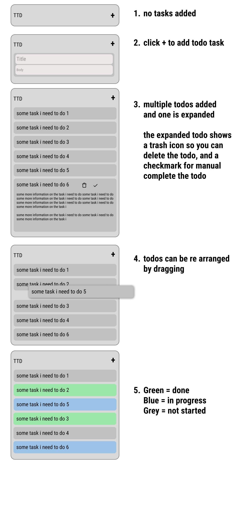

# TTD - Tiny Todo

TTD is a tiny todo list that lives in a floating, always-on-top window next to Claude Code, and that the
agent can read and update too. You and the agent share one local file (`~/.ttd/todos.json`), so a todo you
add in the window is visible to Claude and the other way round. Writes are atomic and conflict-safe (lock, revision check, retry), because
losing an item is the one thing this tool exists to prevent. Click a todo to expand it (body, pencil = edit,
trash, play = in progress, check = done), drag to reorder; grey = not started, blue = in progress, green = done.



Status: beta, v0.1.0. The pieces are a Claude Code plugin (the "mod", `plugin/`), a Tauri v2 window
(`app/`), and a shared store implemented in TypeScript (`plugin/hooks/store/`) and Rust (`crates/ttd-store`),
specified in `docs/contract/STORE.md`. Design and decisions: `docs/DECISIONS.md`, `docs/plan/plan.md`.
Anything marked "unverified" below has not been exercised yet.

## Quick start

1. **Open the window.** Download a build or build it yourself (section 2), then open `TTD.app`. It floats
   above other windows; drag it by its header.
2. **Start Claude Code with the plugin.** Install it (section 1), or from a checkout of this repo run
   `claude --plugin-dir ./plugin`.
3. **Use either side.** Add a todo in the window and ask Claude "what's on my todo list?", or tell Claude
   "add a todo to review PR 12 and mark it in progress" and watch the window update.

### In the window

| To | Do |
|---|---|
| Add a todo | **+**, type a title (body optional), then the check button, Enter in Title, or click anywhere outside the form |
| Cancel a form | the x button or Esc |
| See the body and actions | click the todo |
| Edit a todo | click it, then the pencil |
| Start / finish | click it, then play (blue, in progress) or check (green, done) |
| Delete | click it, then the trash (no undo) |
| Reorder | drag a row |

Grey = not started, blue = in progress, green = done.

### From Claude Code

| Command | What it does |
|---|---|
| `/ttd` | open the window, or focus it if it is already open |
| `/ttd list` | print the list with ids |
| `/ttd add <title>` | add a todo |
| `/ttd start <id>` / `done <id>` / `todo <id>` | set in progress / done / not started |
| `/ttd rm <id>` | delete a todo |
| `/ttd recover` | restore a damaged list from its backup |
| `/ttd help` | all sub-commands |

You can also ask in plain words ("what should I work on next?", "mark the login bug done", "move the release
task to the top"). The agent has its own TTD tools and sees changes you make in the window on your next message.

## 1. Install the plugin

In a Claude Code session:

```
/plugin install ttd --marketplace kristianDKAndersen/ttd
```

Or from a shell:

```
claude plugin install ttd --marketplace kristianDKAndersen/ttd
```

The repository is **private**, so the install needs git credentials that can read it: collaborator access
first, then for example `gh auth login && gh auth setup-git`. The plugin is the `plugin/` folder of this
repo; nothing else ships with it.

Claude desktop-app and SDK sessions: the plugin can read the list there but is **read-only** (see Limits).
Use the Claude Code CLI to let the agent write.

Unverified: the install line has not been run end to end against GitHub (marketplace file
`.claude-plugin/marketplace.json`, plugin source `./plugin`).

## 2. Get the window

The agent tools work without the window; the window is the visual half.

**Download a build.** Needs collaborator access to the private repo. Releases are created as drafts and a
maintainer publishes them.

```
gh auth login
gh release list -R kristianDKAndersen/ttd
gh release download <tag> -R kristianDKAndersen/ttd          # all assets, or add --pattern '*.dmg'
```

Or open https://github.com/kristianDKAndersen/ttd/releases/latest in a browser while signed in. The
release workflow builds a macOS universal app, a Windows build and a Linux build. Exact asset names depend on
the Tauri bundle targets (unverified: the workflow has never run).

**Build from source.** Needs [bun](https://bun.sh) and a Rust toolchain; on Linux also the
[Tauri v2 prerequisites](https://v2.tauri.app/start/prerequisites/) (Debian/Ubuntu:
`libwebkit2gtk-4.1-dev build-essential curl wget file libxdo-dev libssl-dev libayatana-appindicator3-dev librsvg2-dev`).

```
bun install
CI=true bun run tauri build
```

`tauri build` builds the UI itself. On macOS the app lands in `target/release/bundle/macos/TTD.app` (and a
`.dmg` under `target/release/bundle/dmg/`); `CI=true` skips the Finder automation that the dmg step otherwise
needs a logged-in GUI session for. Other platforms: `target/release/bundle/`, binary `target/release/ttd`.
Only a `tauri build` binary embeds the UI: a plain `cargo build` binary loads the Vite dev URL and shows a blank
window, so `/ttd` never launches `target/debug` (see Use it).

### Unsigned binaries: first launch

The builds are not code-signed or notarised, so each OS warns once.

- **macOS** (Gatekeeper): move the app to `/Applications`, then
  `xattr -dr com.apple.quarantine /Applications/TTD.app`, or right-click the app and choose Open.
- **Windows** (SmartScreen): "More info" then "Run anyway".
- **Linux** (AppImage): `chmod +x TTD*.AppImage`, then run it. A `.deb` puts `ttd` on the PATH.

Run the window once: it records its own path in `~/.ttd/app.json`, which is how `/ttd` finds it later
(a path under `target/debug/` is ignored there).

## 3. Use it

- In the window: **+** opens the Title / Body form. Save it with the check button, Enter in Title, Cmd/Ctrl+Enter
  in Body, or by clicking anywhere in the window outside the form (the form closes silently if both fields are
  empty; a body without a title stays open with "Title needed"). The x button or Esc cancels. Switching to
  another app never saves or closes a draft. To change a todo, expand it and press the pencil: the row turns into
  the same form, prefilled, with the same save and cancel rules, and only the fields you changed are written (so
  an agent's edit to a field you did not touch is kept). One form is open at a time; opening another saves the
  first. Pressing **+** while the add form is open just focuses it.
- `/ttd` in Claude Code launches the window; a second launch focuses the existing one. If no window is
  installed it prints the install steps and the release link.
- Sub-commands: `/ttd list`, `add <title>`, `start|todo|done <id>`, `rm <id>`, `recover`, `path`, and
  `op '<json>'` (one store op, prints the envelope; the machine path used by the tests). Details:
  `plugin/README.md`.
- The agent gets six tools: `mcp__ttd__list`, `mcp__ttd__add`, `mcp__ttd__update`, `mcp__ttd__set_status`,
  `mcp__ttd__reorder`, `mcp__ttd__delete`. Items are addressed by `id`. Claude sees your window edits at its
  next prompt (a short `<ttd-todos>` block is attached only when the list changed since it last looked) or in
  the result of its next ttd tool call.
- Environment: `TTD_HOME` (store directory, default `~/.ttd`), `TTD_BIN` (path of the window executable),
  `TTD_NO_LAUNCH=1` (`/ttd` only reports what it would start), `TTD_APP_DIRS` (macOS: folders searched for
  `TTD.app`), `TTD_LOCK_TIMEOUT_MS` / `TTD_LOCK_STALE_MS` (lock wait and stale-lock age). `/ttd` looks for the
  window in this order: `TTD_BIN`, the `app.json` path, the OS install location, then (under `--plugin-dir`
  in a checkout) the `tauri build` output: `target/release/bundle/macos/TTD.app` on macOS, `target/release/ttd`
  elsewhere.
- Data lives in `~/.ttd/todos.json`, plus `todos.json.bak` (a copy of the latest committed file, written
  atomically after each commit) and a lock directory.
- If `todos.json` is damaged, the damaged bytes are never overwritten: they are kept as
  `todos.corrupt-<time>-<token>.json`. With a valid `.bak`, the next write (or the window's **Recover**
  button, `/ttd recover`) restores it, which loses nothing TTD wrote unless `backup_stale` is reported. Whoever
  triggered the restore is told (warnings `corrupt_quarantined`, `restored_from_bak`): the window shows a notice,
  the agent gets it in the tool result and `/ttd` prints it. If the `.bak` rename after a commit failed twice, that
  commit's result carries `backup_stale` (the backup is one change behind); and a restore whose damaged file still
  shows a newer revision than the backup reports `backup_stale` too: the restored list may be missing the latest
  changes, which remain in the quarantined `todos.corrupt-*.json`. A `todos.json` that is not valid UTF-8 counts as
  damaged (it is quarantined byte-for-byte, never rewritten). With no valid `.bak`, writes are refused (`corrupt_no_backup`)
  until Recover, which starts an empty list.

## Limits

- **Writes need the Claude Code CLI.** The mod writes through `$.process`, documented as CLI-only. Desktop-app
  and SDK sessions can read the list, but writes return a clear `io_error`.
- A window edit made mid-turn reaches the model at its next prompt or next ttd tool result, not sooner.
- Windows and Linux are unverified end to end (Windows store IO, NSIS install path, AppImage path,
  undecorated-window resize edges, multi-monitor position memory). The release workflow has never run.
- The model choosing `mcp__ttd__*` tools on its own is not covered by automated tests; engine-level tests and
  real-file `/ttd op` tests cover the same handlers. Manual check: run `claude --plugin-dir plugin`, ask
  "add a todo to fix login", watch the window update.
- Deleting a todo in the window is immediate (no undo); `.bak` is a copy of the current file, not a history.
- Binaries are unsigned (above). The mod API is early access and the plugin was validated against Claude Code
  build 2.1.318 only.
- There is no MCP server yet, so Claude Desktop chat users cannot use TTD in the beta.

### If the repository goes public

Anyone could `/plugin install` and download releases without being a collaborator, runner minutes become free,
an arm Linux runner can join the release matrix, and an updater (`uploadUpdaterJson` in the release action)
becomes practical. While private, collaborator access is required for both the plugin and the downloads.

## Development

```
bun install
bun run shim        # store-backed dev server on 127.0.0.1; TTD_HOME selects the file (default ~/.ttd)
bun run dev:ui      # Vite UI, /api proxied to the shim
bun run verify      # typecheck, store and UI tests, UI build, browser e2e, Rust tests, plugin tests, app smoke, integration
```

`bun run verify` needs Chrome (browser e2e), Rust, the `claude` CLI (its `test:mod` also runs `e2e-mod`, real
`claude -p` sessions) and a GUI session (app smoke). `smoke:app` runs the debug binary
(`bun run tauri build --debug --no-bundle` first) and **refuses to start while a TTD window is open**: quit
TTD first, because single-instance would swallow the launch. Smaller pieces: `bun run test:store`,
`test:ui`, `test:e2e-ui`, `test:rust`, `test:mod`, `test:integration` (cross-process: TS, Rust and mod
writers, watchers, crash and corrupt recovery), `typecheck`. `bun run tauri dev` runs the window against the
Vite dev server (its binary is a dev build and is not what `/ttd` launches).

CI (`.github/workflows/ci.yml`, Ubuntu) runs typecheck, the store and UI bun tests, the UI build,
`claude plugin validate` and `claude plugin test` (CLI from npm, pinned to 2.1.318), `cargo test -p ttd-store`
and `cargo test -p ttd` (with the Tauri Linux packages). Not in CI: browser e2e, app smoke, `e2e-mod`,
integration, and type-checking of the five mod source files (excluded from `tsconfig.json`; the plugin tests
cover them).
Releases: push a tag `v*` or run the `release` workflow manually. It runs CI, checks that the versions in
`tauri.conf.json`, `app/src-tauri/Cargo.toml`, `package.json` and `plugin.json` agree (and equal the tag),
and are plain numeric `MAJOR.MINOR.PATCH` (a pre-release suffix such as `-beta.1` is refused: the Windows MSI bundler rejects it),
creates one draft release, then builds macOS, Windows and Linux into it. A maintainer publishes the draft.

## Next steps

- A plain stdio MCP server, `ttd-store mcp` in the Rust crate (left out of the beta, plan D2).
- Code signing and notarisation (Apple Developer account, Windows signing certificate).
- An updater, which is only practical once the repo is public.
- An undo toast for deletes.
